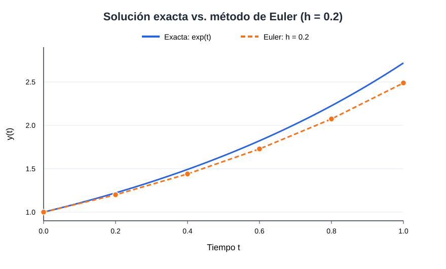

# Ecuación diferencial separable: solución exacta y método de Euler

## Objetivo

Resolver analíticamente una **ecuación diferencial separable** por separación de variables y comparar su solución exacta con la aproximación del **método de Euler** en el intervalo **t ∈ [0,1]**, con paso **h = 0.2**.

## 1. Planteamiento del problema

Se considera:

$$
\frac{dy}{dt} = y,\qquad y(0)=1.
$$

La tasa de cambio de la variable es proporcional a su valor actual, un modelo sencillo de crecimiento ideal sin restricciones.

## 2. Solución exacta por separación de variables

Separando variables:

$$
\frac{1}{y}\,dy = dt
$$

Integramos:

$$
\ln|y|=t+C
$$

Por tanto, $$y(t)=Ce^t$$. Como $$y(0)=1$$, resulta $$C=1$$.

**Solución exacta:**

$$
\boxed{y(t)=e^t}
$$

## 3. Aproximación por el método de Euler

Fórmula de Euler explícito:

$$
y_{n+1}=y_n+h\,f(t_n,y_n)
$$

Aquí $$f(t,y)=y$$ y $$h=0.2$$, por lo que:

$$
y_{n+1}=y_n+0.2y_n=1.2y_n
$$

Partimos de $$t_0=0$$, $$y_0=1$$ y damos **5 pasos** hasta $$t=1$$.

| t | Euler | Solución exacta | Error absoluto |
|---:|---:|---:|---:|
| 0.0 | 1.000000 | 1.000000 | 0.000000 |
| 0.2 | 1.200000 | 1.221403 | 0.021403 |
| 0.4 | 1.440000 | 1.491825 | 0.051825 |
| 0.6 | 1.728000 | 1.822119 | 0.094119 |
| 0.8 | 2.073600 | 2.225541 | 0.151941 |
| 1.0 | 2.488320 | 2.718282 | 0.229962 |

En $$t=1$$, la aproximación de Euler es **2.488320** frente al valor exacto **2.718282**. El error absoluto es **0.229962** (alrededor de **8.46 %**).

## 4. Gráfica



La solución exacta crece más rápido que la aproximación de Euler; con este paso, Euler **subestima** el valor real. Ejecutando el código también se genera `comparacion_euler.png`.

## 5. Cómo ejecutar el proyecto

Requiere **Python 3** y **matplotlib**. Desde la carpeta del repositorio:

```bash
python -m pip install -r requirements.txt
python main.py
```

Se imprimirán la tabla y el error, y se crearán los archivos `resultados.csv` y `comparacion_euler.png`.

Para ejecutar las pruebas:

```bash
python -m unittest discover -s tests -v
```

## 6. Contenido

- `main.py`: solución exacta, Euler, tabla, CSV y generación de gráfica.
- `README.md`: explicación del problema y del procedimiento.
- `requirements.txt`: dependencia para la gráfica.
- `resultados.csv`: tabla calculada.
- `comparacion_euler.svg`: gráfica visible directamente en GitHub.
- `tests/test_euler.py`: pruebas automáticas.

## Conclusión

La separación de variables permite encontrar **exactamente** $$y(t)=e^t$$. Euler, con $$h=0.2$$ en $$[0,1]$$, da $$y(1)\approx2.488320$$, con error absoluto aproximado de $$0.229962$$. El método es sencillo, aunque su precisión depende del tamaño del paso.
